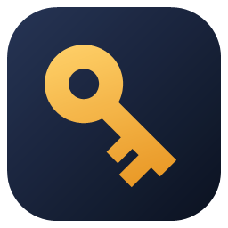

# 密钥匣 KeyBox

一个只做一件事的小软件：把你的 API Key 加密存在本机，要用时一键复制。有 **Windows** 版（`src/`）和 **Mac** 版（`mac/`），两边的 `vault.json` 格式完全一样——复制过去，用同一个主密码就能打开。



## Mac 版

在 [Releases](../../releases) 下载 `KeyBox-mac.zip`，解压后把「密钥匣」拖进「应用程序」。支持 macOS 13 及以上，Apple 芯片和 Intel 都能用。

它没有经过 Apple 公证（那要付费的开发者账号），所以**第一次**打开会被拦住：

- macOS 15 及以上：双击一次，看到提示后去「系统设置 → 隐私与安全性」，在下面点「仍要打开」；
- macOS 13–14：在「应用程序」里按住 Control 点「密钥匣」，选「打开」；
- 或者在「终端」里运行一次 `xattr -dr com.apple.quarantine /Applications/密钥匣.app`。

和 Windows 版的区别：

| | Windows | Mac |
| --- | --- | --- |
| 数据位置 | `%APPDATA%\KeyBox` | `~/Library/Application Support/KeyBox` |
| 免密解锁 | Windows DPAPI | Touch ID / Mac 登录密码（解密钥匙放在钥匙串里） |
| 导入 / 写入环境变量 | Windows 用户环境变量 | `~/.zshrc`、`~/.zprofile` 等 shell 配置文件 |
| 剪贴板 | 不进 Win+V 历史和云剪贴板 | 标记为「隐藏内容」，剪贴板管理工具不记录 |
| 自动锁定 | 空闲、Windows 锁屏 | 空闲、屏幕锁定、睡眠、切换用户 |

快捷键：`⌘N` 新增、`⌘S` 保存、`Esc` 取消、`⇧⌘C` 复制选中的 Key、`⌘E` 编辑、`⌘L` 锁定、`⌘,` 设置；搜索框里按 Return 复制当前选中的 Key，列表里双击也能复制。

Mac 版每次推送到 `mac/` 都由 GitHub Actions（`.github/workflows/mac.yml`）在 macOS 上编译成通用二进制、跑单元测试（含打开 Windows 版写的样本密钥库）、用 `--ui-snapshot` 模式把主要界面走一遍并截图，最后打包 `KeyBox-mac.zip`。本地有 Xcode 的话：

```bash
cd mac
swift test
scripts/build-app.sh          # -> dist/release/密钥匣.app 和 dist/KeyBox-mac.zip
```

## Windows 版安装

```powershell
powershell -ExecutionPolicy Bypass -File install.ps1             # 安装 / 更新
powershell -ExecutionPolicy Bypass -File install.ps1 -Uninstall  # 卸载（不删密钥库）
```

程序装到 `%LOCALAPPDATA%\Programs\KeyBox\KeyBox.exe`，桌面和开始菜单各有一个「密钥匣」快捷方式。重新打包后再运行一次 `install.ps1` 就更新了（运行前先关掉密钥匣）。

## Windows 版用法

双击桌面上的「密钥匣」。

1. **第一次打开**：设置主密码（至少 8 位）。主密码不会存在任何地方，忘了就打不开，请记牢。
2. **新增**：粘贴 Key。认得出前缀的（`sk-ant-`、`sk-or-`、`sk-proj-`、`ghp_`、`hf_`、`AIza`、`sk_live_`…）会自动填好服务商、Base URL、环境变量名和控制台网址；也可以从下拉框挑服务商（OpenAI、Anthropic、DeepSeek、Gemini、OpenRouter、Kimi、通义千问、智谱、硅基流动、xAI、Mistral、Groq、Hugging Face、GitHub、Stripe、Cloudflare），或者直接输入任何名字。
3. **导入环境变量**：把 Windows 用户环境变量里已有的 `*_API_KEY` / `*_TOKEN` / `*_SECRET` 一次收进来（环境变量本身不动）。
4. **用**：
   - 「复制」：复制 Key，30 秒后自动从剪贴板清除，而且不进 Win+V 剪贴板历史和云剪贴板。
   - 在搜索框里输几个字然后按 **Enter**，直接复制当前选中的 Key；列表里**双击**也能复制，右键有菜单。
   - 「复制 PowerShell 行 / Bash 行 / .env 行」：直接得到 `$env:DEEPSEEK_API_KEY = '…'` 这类可以粘贴的命令。
   - 「写入用户环境变量」：把 Key 写进 Windows 用户环境变量（会先提醒你那是明文）。
   - 「测试这个 Key」：只在你点击时，向那个服务商发一次只读请求（列模型 / 查账号），看 Key 还能不能用；DeepSeek 会顺便显示余额。自定义服务商只要填了 OpenAI 兼容的 Base URL 也能测。

快捷键：`Ctrl+F` 搜索、`Ctrl+N` 新增、`Ctrl+S` 保存、`Esc` 取消、`Ctrl+L` 锁定。

## 安全

- 数据在 `%APPDATA%\KeyBox\vault.json`，整个条目列表用 **AES-256-GCM** 加密，密钥由主密码经 **PBKDF2-HMAC-SHA256（60 万次迭代）** 派生；文件头也参与认证，任何改动都会被发现。
- 每次保存先写临时文件再替换，上一版留作 `vault.json.bak`。备份就复制整个文件夹。
- 空闲 5 分钟（可改）自动锁定；Windows 锁屏时一起锁；锁定和退出时会清掉它复制到剪贴板的 Key。
- 设置里可以开「在这台电脑上免密解锁」：用 Windows DPAPI 保护一份解密钥匙。方便，但你这个 Windows 账户下的程序也能借此解开密钥匣，所以默认关闭。
- 不联网。唯一的网络请求是你点「测试这个 Key」时发给那个服务商的那一次。

## 开发

需要 .NET 10 SDK（运行 exe 只需要 .NET 10 Desktop Runtime）。

```powershell
# 核心检查（加解密、篡改检测、改密码、免密解锁、导入识别、连接测试）
dotnet run --project tests\KeyBox.Tests

# 测试 + 打包成 dist\KeyBox.exe（约 0.3 MB；加 -SelfContained 则自带运行时，可在没装 .NET 的电脑上用）
powershell -ExecutionPolicy Bypass -File build.ps1

# 界面冒烟测试：用 UI Automation 真的操作 exe（新建、新增、复制、搜索、锁定、删除、重启、空闲锁定）并截图
dotnet build tests\KeyBox.UiSmoke
tests\KeyBox.UiSmoke\bin\Debug\net10.0-windows\KeyBox.UiSmoke.exe dist\KeyBox.exe shots
```

`KeyBox.exe --data <文件夹>` 可以换一个数据文件夹（测试就是这样做的，不会碰你的真实密钥库）。图标（含 Mac 的 `AppIcon.iconset`）由 `tools\make-icon.ps1` 生成。

`tests/fixtures/` 里是两边互相验证用的样本密钥库：`windows-vault.json` 由 `KeyBox.Tests --write-fixture tests\fixtures` 生成、Mac 测试负责打开；`mac-vault.json` 来自 Mac CI，Windows 测试负责打开。

| 文件 | 作用 |
| --- | --- |
| `src/KeyBox/Core/Vault.cs` | 加密文件格式、解锁、保存、改密码 |
| `src/KeyBox/Core/Providers.cs` | 服务商预设、按 Key 前缀 / 变量名识别 |
| `src/KeyBox/Core/KeyTester.cs` | 「测试这个 Key」 |
| `src/KeyBox/Core/SecureClipboard.cs` | 不进剪贴板历史的复制 + 定时清除 |
| `src/KeyBox/Core/DeviceUnlock.cs` | DPAPI 免密解锁 |
| `src/KeyBox/Core/EnvScanner.cs` | 从用户环境变量导入 |
| `src/KeyBox/MainWindow.xaml` | 解锁页、列表、详情、编辑 |
